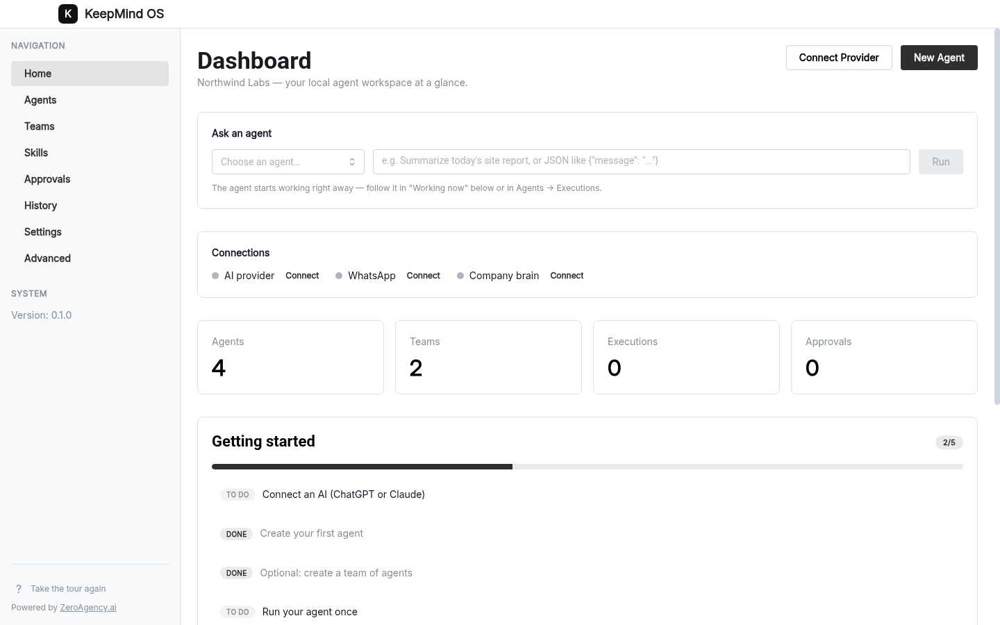
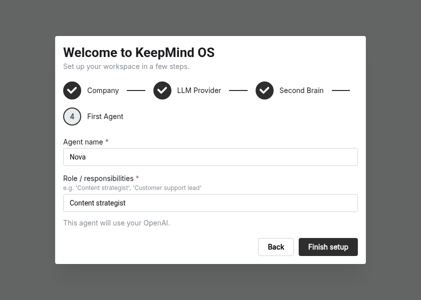
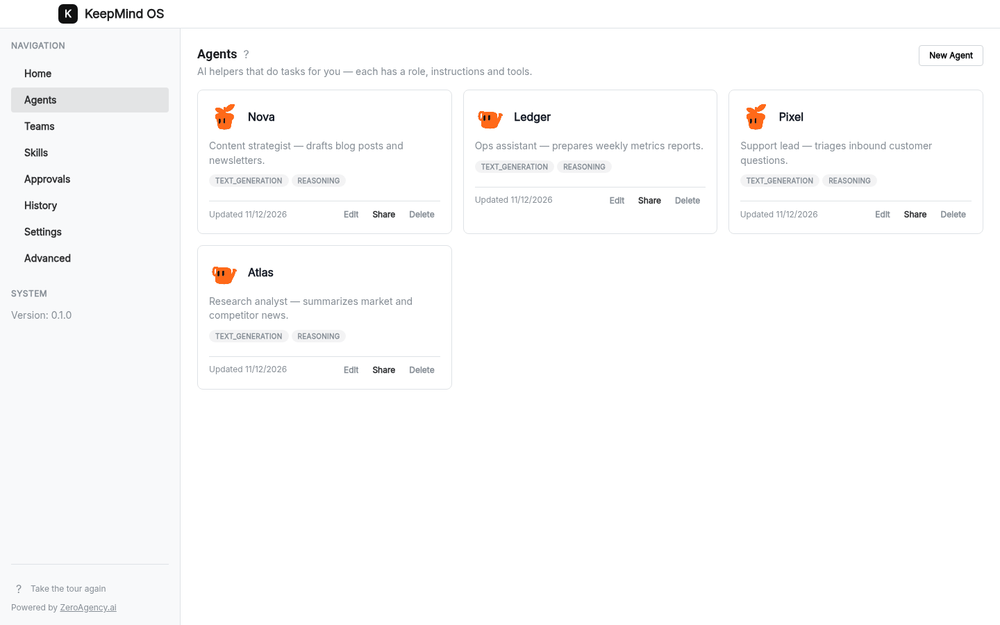
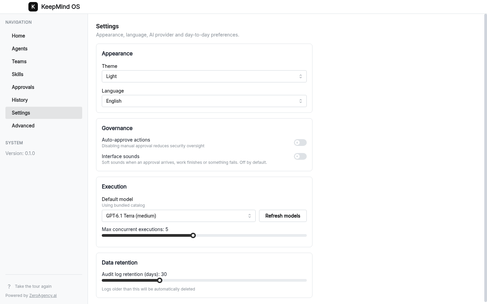

# KeepMind OS

A free, open-source developer workspace for goal-driven AI agent work. Local-first, MIT licensed, with your own models and data.

[](LICENSE)
[](https://github.com/criptogus/keepmind-os/releases/latest)


[Homepage](https://keepmind.io)

## Why

Agent teams need a workspace where people can configure their tools, review sensitive actions, and inspect what happened. KeepMind OS brings execution, governance, memory, and integrations into a desktop app with local SQLite storage. Model calls and enabled integrations use external services.

## Features

**Developer workspace**

- Start with a goal, acceptance criteria and a repository-oriented template.
- Track tasks, dependencies, comments and deliverables on a work board.
- Review results before accepting completion; turn corrections into proposed project rules.
- Export your work as JSON. No paid plans or KeepMind account required.
- Optional local hybrid memory search and a standalone Node.js runner for your own server.

See [Workspace guide](docs/WORKSPACE.md) for setup, guarantees and current limitations.

**Agents and teams**

- Configure agents with prompts, models, tools, skills, and distinct avatars.
- Build team workflows with sequential, parallel, or conditional steps.
- Run agents and teams, inspect execution history, and cancel agent runs.
- Use OpenAI and Anthropic through OAuth or API keys.

**Governance and visibility**

- Review sensitive tool actions in a human approval queue and edit governance rules.
- Inspect audit logs and model/skill routing decisions, including selection reasons.
- Track estimated token costs per call and configure monthly budgets checked before each call, including concurrent in-process reservations. Estimates are not provider invoices; interrupted streams and estimation errors can exceed budgets.

**Memory and skills**

- Keep a personal Markdown memory vault with a local SQLite retrieval index.
- Consolidate memories, retain superseded history, and retrieve across the full active corpus. Optional local embeddings combine semantic and keyword recall.
- Create skills or import them from GitHub with provenance and text-only import restrictions.

**Automation and integrations**

- Schedule interval or daily triggers, or start agents through token-protected local webhooks.
- Connect WhatsApp through Baileys and external application tools through Composio.
- Connect to a Second Brain / KeepMind Corp server to search, read, and capture shared knowledge, with configurable write access and PII checks.

**Desktop workspace**

- English and Brazilian Portuguese interface strings, onboarding, theme settings, and an analytics dashboard.
- Local SQLite persistence for agents, teams, settings, approvals, and execution records.

## Screenshots



Ask an agent, monitor workspace activity, and follow the getting-started checklist from Home.

<table>
  <tr>
    <td width="33%"></td>
    <td width="33%"></td>
    <td width="33%"></td>
  </tr>
  <tr>
    <td>Set up your company, LLM provider, second brain, and first agent.</td>
    <td>Browse and manage your agents from their cards.</td>
    <td>Configure appearance, language, governance, execution, and data retention.</td>
  </tr>
</table>

*Screenshots use fictional demo data.*

## Download

Get the [latest desktop release](https://github.com/criptogus/keepmind-os/releases/latest).

| Mac | DMG filename |
| --- | --- |
| Apple Silicon | `KeepMind-OS-<version>-arm64.dmg` |
| Intel | `KeepMind-OS-<version>.dmg` |

Replace `<version>` with the release version. ZIP variants are also available.

Builds are currently unsigned and not notarized. On first launch, macOS Gatekeeper may block the app. Right-click the app and choose **Open**, or use **System Settings > Privacy & Security > Open Anyway**.

## Build from source

Requires Node.js **>= 24.11.0** and npm. From the repository root:

```bash
npm ci
npm run build
npm start
```

Available commands:

| Command | Purpose |
| --- | --- |
| `npm run dev` | Start the Vite renderer development server only |
| `npm run build` | Build the renderer, main process, and preload bridge |
| `npm start` | Launch Electron using the built output |
| `npm test` | Run unit tests |
| `npm run typecheck` | Check TypeScript types |
| `npm run dist:mac` | Build macOS DMG and ZIP packages |

## Configuration

KeepMind OS itself is free. Model providers and connected services may charge for their usage. Bring your own credentials; there is no KeepMind subscription.

Configure OpenAI and Anthropic in the app's settings using OAuth or API keys. The `OPENAI_API_KEY` and `ANTHROPIC_API_KEY` environment variables are also supported. Configure optional integrations in the app before enabling them.

## Architecture

Electron and TypeScript separate privileged operations from the React interface:

- **Main:** window lifecycle, agent/team execution, integrations, credentials, and SQLite storage.
- **Preload:** a typed IPC bridge between the renderer and main process.
- **Renderer:** React views and workspace state.
- **Runner:** standalone Node.js CLI for read-only developer work and interval routines. Desktop execution still lives in the main process; the two do not automatically synchronize.
- **Shared:** common types, model metadata, and avatar utilities.

See [Architecture](docs/ARCHITECTURE.md) and the [architecture decisions](docs/adr/). The architecture document includes design proposals; the source is authoritative for current behavior.

## Security

See [SECURITY.md](SECURITY.md) for the security model and private vulnerability reporting.

## Contributing

See [CONTRIBUTING.md](CONTRIBUTING.md) for setup, checks, and pull request guidelines.

## Roadmap

See the [development roadmap](docs/ROADMAP.md) for planned work.

## License

[MIT](LICENSE). See [third-party notices](THIRD_PARTY_NOTICES.md) for dependency notices.


### Resume interrupted work

The developer workspace now journals model responses and tool results. Use **Resume checkpoint** after an interruption. Completed tools are not replayed; uncertain external effects require a verified result before continuing. Pending checkpoint-bound approvals survive restart within their original 24-hour window. The headless runner supports `--inspect`, `--resume` and `--reconcile`. See [execution guarantees and boundaries](docs/WORKSPACE.md) for limits, data retention and recovery instructions.
