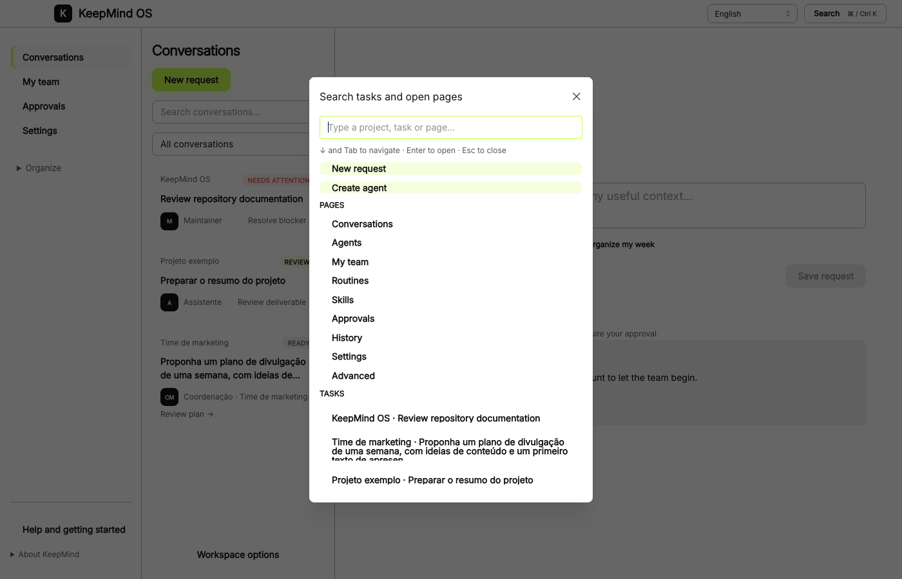
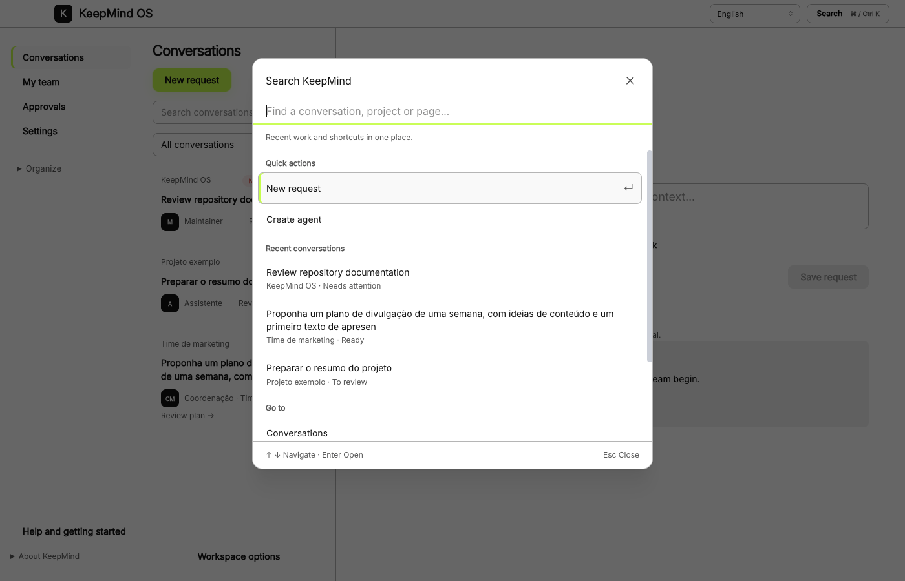

# Fluxos corporativos e lacunas em relação ao Paperclip

Data: 13/11/2026. Base analisada: KeepMind OS, branch `codex/conversation-first`, commit `7bb2733`, antes das alterações de busca deste acompanhamento. Trata-se da versão do PR #12, não de uma afirmação de que tudo já está no main. Análise de código e documentação pública; nenhuma conta de cliente, CRM, e-mail ou anúncios foi acessada.

## Diagnóstico

Há componentes úteis de automação, mas ainda não um processo corporativo completo, durável e verificável configurável por uma pessoa não técnica. A conversa deve continuar sendo a entrada do produto; por trás dela é necessário um motor explícito de processos, com responsáveis, etapas, evidências e limites. Uma skill descreve como fazer algo; não substitui credenciais, execução persistente ou validação.

| Fluxo | O que existe | O que impede dizer que está pronto |
|---|---|---|
| Reclamação por e-mail → correção → QA → PR | Gatilhos, delegação, execução de times, ferramentas locais, MCP/Composio e aprovações | Sem ingestão de e-mail validada de ponta a ponta, deduplicação por evento, etapas QA obrigatórias, workspace Git isolado por caso ou recibo vinculando QA ao commit final |
| Análise diária de leads de uma construtora | Rotinas criam pedidos; leitura de planilhas e conectores genéricos permitem buscar dados acessíveis | Conector CRM e contrato de métricas precisam ser configurados e testados; comparação histórica, qualidade de dados e comprovação dos resultados ainda não compõem um ciclo de melhoria |
| Google/Meta: análise e novos testes | Conexões externas genéricas; permissões para ações | Não foram encontrados fluxos nativos de campanha, reconciliação de alterações, controle de experimentos ou validação dessas contas. Não confundir autenticar com operar corretamente |
| Reunião → decisões → responsáveis → acompanhamento | Integração Granola, pesquisa de reuniões e memória | Faltam extrair compromissos como tarefas rastreáveis, confirmar responsáveis/prazos, detectar duplicação e acompanhar cumprimento |
| Vendas: oportunidade parada → próximo passo | Agendamento e agentes com contexto | Falta sincronização de estágios CRM, política de contato e medição de avanço/resultado |
| Projetos: atrasos e dependências | Pedidos têm dependências, versões e revisão | Falta ligar a meta, marco, responsável, prazo e plano de recuperação persistente |
| Financeiro: conciliação e cobranças | Leitura de planilhas/documentos e ações aprovadas | Integração com ERP/banco, trilha por lançamento e reconciliação são específicas; preparar análise não equivale a autorizar pagamentos |
| Compras/obras: propostas e desvios | Leitura de documentos, especialistas e entregas | Falta comparar bases equivalentes, validar quantitativos e rastrear decisão/contrato/orçamento |

### Evidência no código

- `src/main/agent/TriggerManager.ts`: intervalos e horário diário, regras/último disparo persistidos, webhook por token e fila específica de WhatsApp. Não há uma fila genérica durável com política completa de repetição/deduplicação. `lastRunAt` é salvo antes da execução; a falha é registrada em log.
- `src/main/main.ts` (`triggerManager.attach`): a perda do `webhookPayload` identificada nesta análise foi corrigida na continuação do PR #12. A origem e o conteúdo agora persistem no pedido; `Idempotency-Key` evita nova execução do mesmo evento. Isso ainda não substitui uma fila durável nem um processo com múltiplas etapas. Ver [implementação e limites](table-errors-motion.md).
- `src/main/main.ts` (`startWebhookServer`): receptor em `127.0.0.1`; não é diretamente acessível por um site externo. É necessário um ingresso autenticado e operável, não expor o app indiscriminadamente.
- `src/runner/cli.ts` (`--watch`): permite rotinas por intervalo fora do desktop enquanto o processo está ativo. Isso não equivale a serviço 24/7 instalado e monitorado; desligar o computador interrompe a operação local.
- `src/main/agent/TeamExecutionEngine.ts`: etapas sequenciais/paralelas, dependências e condições tipadas. O estado das etapas vive na execução em memória; checkpoints de ferramentas individuais não equivalem à retomada de um processo entre vários agentes.
- `src/main/main.ts` (`delegateTask`): delegação com limite de profundidade e registro de auditoria. Não é uma política obrigatória de desenvolvimento → QA → aprovador.
- `src/main/work/WorkManager.ts`: versões, aceite, correções e regras do projeto. Não há uma máquina de estados de QA independente ligada ao SHA do PR.
- `src/main/governance/ActionPolicy.ts`: comandos, escrita, envio e `composio_execute` pedem aprovação. Portanto, vários fluxos com escrita não são hoje completamente autônomos.
- `src/main/integrations/ComposioManager.ts`: autenticação/catálogo/execução genéricos, com identidade de conexão `keepmind-local` por instalação. Não presumir isolamento de credenciais por pessoa/empresa igual a uma plataforma corporativa multiempresa.
- `src/shared/types.ts`: agentes possuem `managerId` e orçamento; já existe parte do organograma. `WorkTask.goal` é o texto do pedido, não uma árvore de objetivos mensuráveis.

## O que trazer do Paperclip

Prioridade de produto, não promessa de implementação já concluída:

1. **Rotina como processo rastreável.** Gatilho → tarefa com dono → histórico → política de concorrência/recuperação. O Paperclip distingue rotinas de despertares periódicos sem trabalho; nossa experiência deve pedir “quando”, “qual resultado” e “quem responde”. [Rotinas](https://docs.paperclip.ing/guides/projects-workflow/routines/).
2. **Etapas de revisão impostas pelo sistema.** Desenvolvimento não encerra sozinho uma tarefa que exige QA; rejeição devolve ao executor e rodadas sem convergência escalam para uma pessoa. Essa é a lacuna mais importante do primeiro exemplo. [Políticas de execução](https://docs.paperclip.ing/guides/power/execution-policy/).
3. **Objetivos acima de pedidos.** Uma meta, como melhorar conversão de leads, deve conectar projetos, rotinas e decisões, com indicador e período definidos. [Objetivos](https://docs.paperclip.ing/guides/projects-workflow/goals/).
4. **Orçamento por empresa/projeto e agente.** Mostrar consumo acumulado e limites operacionais; no KeepMind não tratar limite de tokens como autorização para gastar verba publicitária. [Custos e limites](https://docs.paperclip.ing/guides/day-to-day/costs/).
5. **Conexões com identidade e permissões por ação.** Diferenciar acesso humano, agente elegível e permissão de consultar/alterar; listar o que cada conta conectada realmente permite. [Acesso a conexões](https://docs.paperclip.ing/connectors/access-model/).
6. **Espaço de execução e prova de entrega.** PR ligado a um commit, ambiente de teste, arquivos e evidências verificáveis; não apenas relato do agente. [Revisão GitHub](https://docs.paperclip.ing/connectors/github-review-bot-setup/).

A referência tem funcionalidades experimentais e dependentes de configuração. A comparação acima não presume que instalar Paperclip sozinho configura e-mail, CRM ou anúncios, nem certifica sua execução em produção.

## Decisão de arquitetura antes de ampliar o motor

Vale testar o Paperclip como serviço de orquestração atrás da interface do KeepMind, em vez de presumir que devemos reconstruir todos os seus mecanismos. A prova deve mapear uma conversa para uma tarefa/processo, conectar agente executor e QA, preservar permissões e retornar decisões/evidências ao chat. Deve haver uma única fonte de verdade para estados e orçamento; dois motores decidindo a mesma execução criariam duplicação e divergência.

Comparar essa integração com estender o motor atual usando os mesmos testes de falha e retomada. A escolha precisa considerar operação local/offline, hospedagem contínua, identidade, dados e manutenção. Não foi tomada nesta alteração. A licença MIT do repositório de referência não dispensa revisar as dependências e runtimes que seriam distribuídos; nenhum pacote do Paperclip foi importado.

## Três fluxos de referência

### Atendimento → produto

E-mail recebido → validar origem e deduplicar → agente de triagem reproduz/classifica → responsável define prioridade → desenvolvimento trabalha em branch isolada → QA independente testa o SHA exato → correções retornam ao desenvolvimento → PR pronto para decisão humana.

A entrega deve mostrar: problema original, reprodução, mudança, testes executados e resultados, pontos não testados, impacto, risco residual e plano de reversão. Uma atualização no código invalida a avaliação anterior até nova verificação. Se não houver ambiente ou reprodução suficiente, o estado é “precisa de validação”, não “aprovado”.

A “nota de firmeza” deve ser um parecer com evidências: **bloqueado / precisa de validação / pronto para revisão**. Uma porcentagem fornecida pelo agente não é probabilidade comprovada de sucesso. Podemos adicionar um índice baseado em critérios explícitos, mas só chamá-lo de probabilidade após calibração com resultados reais. Merge e publicação são decisões separadas do QA.

### Inteligência comercial diária

Buscar leads/contatos/visitas/propostas/vendas → validar atualização e duplicação → comparar empreendimentos, canais e etapas em períodos equivalentes → separar fatos de hipóteses → entregar “manter / corrigir / testar” → responsável aprova mudanças relevantes → medir resultado depois.

Exemplos: tempo até primeiro contato, leads sem retorno, visitas que não viram proposta, perdas por motivo e origem com melhor qualidade. Não atribuir a uma campanha uma mudança causada por sazonalidade, atraso de registro ou perfil diferente de leads. Quando a amostra for insuficiente, reportar essa limitação em vez de inventar tendência.

### Campanhas e experimentos

Conectar conta e verificar permissões → ler dados com janela de atribuição explícita → identificar hipótese → propor teste com objetivo, duração e limite → executar apenas o escopo previamente autorizado → observar resultado → manter, interromper ou reverter.

Começar com leitura e propostas; permitir execução delimitada após validar contas e ferramentas. Aumentar verba, publicar nova campanha ou mudar público sensível deve obedecer à política definida pelo dono. Não é necessário alterar anúncios todos os dias só porque a análise é diária. A [API oficial do Google Ads](https://developers.google.com/google-ads/api/docs/get-started/introduction) suporta consulta e gerenciamento de campanhas; isso não prova que o conector do KeepMind já atende cada operação. A página oficial da Meta não pôde ser consultada nesta sessão; não se afirmam escopos ou permissões específicos dela.

## Outros processos úteis

- **Vendas:** propostas vencendo, próximos contatos sugeridos, revisão de descontos, renovação e expansão de contas.
- **Reuniões:** preparação com histórico, ata com decisões confirmadas, pendências e cobrança de responsáveis.
- **Projetos:** desvios de prazo/custo, dependências bloqueadas, relatório semanal e alternativas de recuperação.
- **Financeiro:** documentos faltantes, conciliação assistida, previsões de caixa e rascunhos de cobrança; pagamento separado e explicitamente autorizado.
- **Operação/obras:** diário de obra, comparação orçamento × realizado, materiais em risco e revisão de propostas de fornecedores.
- **Pessoas:** onboarding, treinamentos pendentes e respostas com fontes da política interna; decisões sobre pessoas ficam com responsáveis humanos.
- **Sucesso do cliente:** temas recorrentes de reclamações, sinais de abandono e planos de recuperação acompanhados.

## Sequência recomendada

**Primeiro:** motor persistente de processos e eventos; preservar payload, deduplicar, definir estados, responsáveis, timeout, repetição e interrupção; retomar depois de reiniciar. Colocar status e decisões na conversa existente.

**Depois:** um fluxo de referência com leitura diária de leads e um fluxo desenvolvimento → QA → PR, ambos com dados/ambientes controlados, evidência por etapa e testes de falha.

**Então:** conectar contas reais, validar permissões por operação e liberar melhorias delimitadas em campanhas. Um construtor visual genérico de fluxos não é pré-requisito: a pessoa descreve o objetivo e confirma um plano legível.

Critério de conclusão: demonstrar do evento à entrega, repetir o mesmo evento sem duplicar ações, interromper/reiniciar no meio, provocar falha de conector, rejeitar no QA e comprovar que uma ação sem permissão não acontece.

## Busca: auditoria e implementação

1. Abrir busca: a captura anterior mostrou modal estreito e alto, opções visualmente semelhantes e textos de tarefas cortados.
2. Encontrar trabalho: a versão nova coloca ações rápidas, conversas recentes e páginas em grupos; a busca aceita múltiplas palavras, ignora acentos e prioriza o título.
3. Navegar: campo fixo, lista rolável, item selecionado neutro com marca verde-limão; setas mantêm a digitação no campo e Enter abre a seleção. Escape fecha, seguindo o [padrão de combobox do W3C](https://www.w3.org/WAI/ARIA/apg/patterns/combobox/).
4. Recuperar: estados de carregamento, nenhuma correspondência e erro com nova tentativa; páginas e ações continuam acessíveis se a consulta de conversas falhar.

Capturas: `evidence/search-before.png`, `evidence/search-after.png`, `evidence/search-empty-narrow.png`. A busca cobre títulos, projetos e descrições de pedidos acessíveis, não conteúdo integral de mensagens ou anexos. Sem nova biblioteca ou migração. Verificação visual não certifica acessibilidade completa.

### Capturas da busca

Antes:

Depois:

### Verificação semântica da análise

Jev `jev-1.14.0` avaliou três afirmações de prontidão contra observações de código (831 tokens de entrada, 133 de saída). Rejeitou as afirmações de pipeline completo e otimização de anúncios pronta; a afirmação condicional sobre análise diária teve confiança baixa (0,38), portanto permanece explicitamente dependente de fonte, configuração e teste real. Os resultados e distribuições estão em `evidence/corporate-readiness-semantic-*.json`; são auxílio de revisão, não teste de capacidade.

### Validação e revisão da alteração

`npm run verify:ux` passou com 241 testes unitários em 35 arquivos, 1 integração e 42 cenários Electron, além de tipos, build, runner, varredura de segredos e inventário de 462 dependências. O smoke foi estendido para capturas adicionais da busca em português e tema escuro. A falha de consulta e a recuperação são exercitadas por servidor HTTP local controlado, através da ponte real do Electron, sem contas externas.

**Standards:** corrigidos clique do botão Limpar (eventos de ponteiro da seção do campo) e preservação da seleção por chave estável quando a consulta assíncrona termina. O teste usa clique de mouse real e seleção antes/depois da resposta atrasada. **Spec:** corrigida prioridade de palavras separadas/invertidas no título. Os revisores confirmaram os três ajustes por leitura de código.

A primeira tentativa de simular carregamento substituindo a ponte Electron não funcionou, pois ela é imutável; foi substituída pelo servidor local. Essa execução falhou e não é contada como validação bem-sucedida. Nenhum fluxo corporativo descrito como lacuna foi ativado ou apresentado como implementado nesta mudança. PR #12 permanece sem merge.
